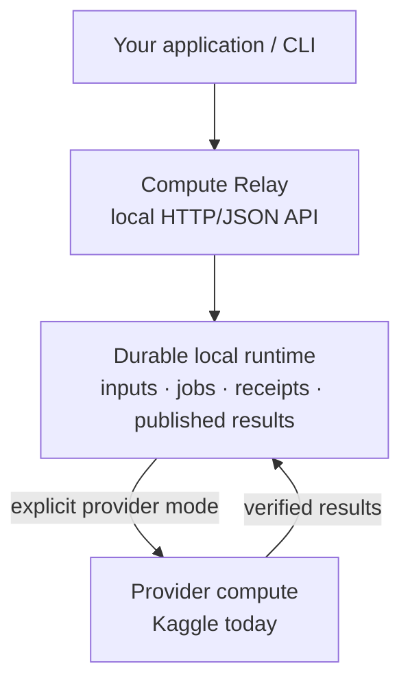

# Compute Relay

Compute Relay is a self-hosted control plane for **finite compute jobs**. Applications talk to a
local HTTP/JSON API instead of embedding provider SDKs or credentials. The runtime gives jobs a
durable identity, preserves attempts and recovery state, and verifies published result bytes.
Kaggle is the first provider adapter.



Without provider flags, `serve` stops at the durable local runtime. Provider work starts only in an
explicitly configured mode with finite authorization. There is no public release yet; read
[current status](docs/status.md) before depending on a capability.

## Quick start

Requirements: Git and the Go version pinned in [`go.mod`](go.mod).

```sh
git clone https://github.com/vankhaivn/compute-relay.git
cd compute-relay
go build -trimpath -o compute-relay ./cmd/compute-relay
./compute-relay help
```

Then follow **[Getting started](docs/getting-started.md)** for a complete local walkthrough and
**[Kaggle runtime](docs/kaggle-runtime.md)** or **[Managed connections](docs/managed-connections.md)**
for provider execution. All usage guides are listed in [docs](docs/README.md); contributors start
with [CONTRIBUTING.md](CONTRIBUTING.md).

Compute Relay is licensed under [Apache-2.0](LICENSE). Provider services, uploaded data, models and
third-party dependencies retain their own terms and licenses.
