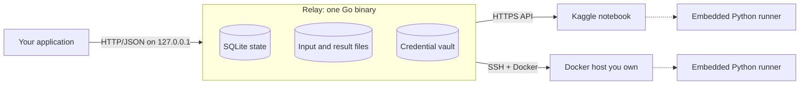

# Compute Relay

Self-hosted control plane for finite remote compute jobs. Your application talks to Relay over a
local HTTP/JSON API; Relay runs each job on a Kaggle account or a Docker host you own (over SSH),
then hands back verified result files. Accounts and machines belong to you; there is no hosted
service.



What Relay guarantees:

- **Nothing runs without explicit permission.** Admitting a job does not start it; each attempt needs
  its own finite authorization. No automatic resubmission, provider/account switching or CPU fallback.
- **Lost responses are safe.** Requests carry idempotency keys; after any uncertainty Relay only
  observes the original remote resource and never creates a second one.
- **Results are verified.** Output files are published only as a complete set whose bytes and
  SHA-256 match the runner's manifest.

## Quick start

Requires Go 1.27.1 (pinned in [go.mod](go.mod)). The Relay host needs no Python or Docker.

```sh
git clone https://github.com/vankhaivn/compute-relay.git
cd compute-relay
go build -trimpath -o compute-relay ./cmd/compute-relay
./compute-relay help
```

Then follow [Getting started](docs/getting-started.md): create an installation, issue tokens, add a
connection and run a first job.

## Documentation

| Read when you want to… | Document |
|---|---|
| Install and run a first job | [Getting started](docs/getting-started.md) |
| Run, back up, upgrade or recover an installation | [Operations](docs/operations.md) |
| Add and configure Kaggle or SSH connections | [Connections](docs/connections.md) |
| Write, submit and control jobs | [Jobs](docs/jobs.md) |
| Collect, download and clean up results | [Results and cleanup](docs/results-and-cleanup.md) |
| Stage first, start later, use deadlines or secrets (SSH) | [Prepare and start](docs/prepare-start.md) |
| Use Kaggle | [Kaggle](docs/kaggle.md) |
| Use an SSH Docker host | [SSH hosts](docs/ssh-hosts.md), [storage](docs/ssh-storage.md), [host health](docs/ssh-host-health.md) |
| Look up request and response schemas | [API contracts](api/README.md) |
| Understand the safety rules behind the design | [Design](docs/design.md) |
| Change the code | [CONTRIBUTING.md](CONTRIBUTING.md), [Development](docs/development.md) |

## Status

Pre-release. Live-tested so far:

| Path | Live result |
|---|---|
| Kaggle CPU and GPU (2× Tesla T4) | Execution, logs, restart while running, verified results, cleanup |
| SSH Docker host (macOS Intel) | Execution, prepare/start with secret and deadline, cancel, cleanup, restart, shared capacity |
| Not yet tested live | Host sleep/reboot/engine restart, HTTP/2 or proxies for downloads, network filesystems |

Licensed under [Apache-2.0](LICENSE). Provider services, data, models and dependencies keep their
own terms.
