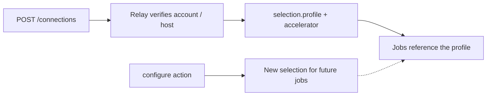

# Connections

A connection is a saved provider login (a Kaggle token or an SSH host login). Verifying it produces
a *selection* — an immutable profile your jobs must reference. All paths below are under
`/v1/workspaces/{w}`.



## Discover

- `GET /v1/info` — check `managed_connections`, `connection_configuration`, `attempt_authorization`.
- `GET /providers` — installed provider descriptors, their write-only credential fields,
  capabilities (`max_remote_wall_seconds`, `concurrency`, …) and vault availability.

## Create

`POST /connections` with a manage token:

```json
{
  "provider_type": "kaggle",
  "label": "Main Kaggle",
  "credentials": {"api_token": "ENTERED_IN_A_SECRET_FIELD"},
  "configuration": {"max_remote_wall_seconds": 3600}
}
```

Send credentials only in the request body — never in URLs, command lines, logs or job bundles.
Kaggle needs only `api_token` (Relay discovers the account). SSH fields are in
[SSH hosts](ssh-hosts.md#create-the-connection). `configuration` is optional; verification runs
asynchronously.

## Change

`POST /connections/{id}/actions` with a manage token, an `Idempotency-Key` and the current
`expected_revision`:

| Action | Effect |
|---|---|
| `check` | Re-verify and publish a fresh selection. |
| `configure` | Change limits (below). No provider call; publishes a new selection for future jobs. |
| `replace_credential` | New credential for the **same** account or host. A different account needs a new connection. |
| `disable` / `enable` | Stop / resume new admission. Existing work keeps recovering. |
| `remove` | Refused while dependent work is queued, active, uncertain or awaiting collection. The ID stays readable. |
| `install_image` | SSH only; see [SSH hosts](ssh-hosts.md#install-the-execution-image). |

```json
{
  "action": "configure",
  "expected_revision": 2,
  "configuration": {"max_remote_wall_seconds": 7200, "max_active_attempts": 2}
}
```

| Configuration field | Range | Applies to |
|---|---|---|
| `max_remote_wall_seconds` (required in `configure`) | Up to the provider's maximum: 86400 Kaggle, 604800 SSH | Both |
| `max_active_attempts` | 1–64, default 1 | Both |
| `max_processes` | 1–65536, default 4096 | SSH |
| `storage_budget` | See [SSH storage](ssh-storage.md#budget) | SSH |
| `host_health` | See [host health](ssh-host-health.md#thresholds) | SSH |

Omitted optional fields keep their saved values. Track the outcome with
`GET /connection-operations/{id}`. Existing jobs and grants always keep the selection they were
admitted with. A pending request may retain an older selection after a check or compatible
configuration change: admission atomically verifies the same connection, workspace, account,
credential generation, resource class and pinned runtime identity, plus current limits for the
requested wall time, internet and inputs. SSH health/storage policy updates do not change host
identity; current health and storage gates still apply. Admitted work retains its original limits.

An enabled connection update in progress returns HTTP 429 with `Retry-After: 1`,
`recommended_action: wait` and `details.reason: connection_update_pending`; retry the exact request
and idempotency key. Once the update settles, incompatible or disabled selections return the
existing stale-selection conflict. A new selection needs a new request identity. Exact admitted
request replay always returns its original receipt, even after later connection changes.

A check keeps the last verified selection while it is pending. A temporary provider or transport
failure preserves that selection and does not turn it into a stale revision or rejected credential.
A genuine credential rejection still disables it. An unavailable connection without a usable
verified selection returns HTTP 503 with `PROVIDER_UNREACHABLE`,
`details.reason: connection_unavailable`, safe operation retry and `Retry-After: 5`.

Failed operations keep the broad `problem` and may add a closed `cause` identifier for the failed
provider step. `cause` is absent when no typed diagnostic is available. This diagnostic does not
change authentication, selection retention or retry policy.

## Concurrency

The provider descriptor's `capabilities.concurrency` gives `support`, `scope` (`account` for Kaggle,
`resource` for SSH), `minimum`, `maximum` and `default`. The connection reports:

| Field | Meaning |
|---|---|
| `configured_limit` | This connection's `max_active_attempts`. |
| `effective_limit` | Lowest limit across every connection reaching the same account or machine; null if unknown. |
| `resource` | Opaque `{kind, resource_id}` of the shared machine. Compare IDs, not labels or addresses. |
| `active_attempts` | Preparing, prepared and possibly running attempts in that scope; null if unknown. |
| `wait_reason` | Current local capacity gate, or null. |

Connections to the same account or machine share one budget — a second login does not add capacity.
Lowering a limit never stops running work. Prepared holds and uncertain attempts keep their slot
until resolved; a local timeout or cancel request does not free it. Confirmed remote inactivity
frees the slot even if results are not collected yet.

A queued job's status shows `scheduling.reason`, for example `execution_authorization_required`,
`workspace_fifo`, `worker_limit`, `account_capacity`, `resource_capacity`,
`resource_identity_unverified` or `resource_reservation_unresolved`.

## Quota

Kaggle quota entries expose `limit`, `used`, `local_reserved`, `remaining` and `reset_at` (seconds;
allowance rounded down, usage rounded up). `reset_at` appears only when the provider reports it —
Kaggle currently does not. Missing or stale values mean **unknown**, never zero or unlimited. SSH
returns an empty `quotas` array. Reading quota never calls the provider and never authorizes work.
