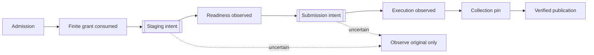

# Design

Relay serves one trusted operator's applications. The application owns what a job means and any
external sessions; Relay owns durable orchestration, provider boundaries and verified result bytes.
Go serves the API, SQLite holds metadata, private directories hold input and result bytes, and the
embedded Python runner executes remotely.

## Invariants

These rules hold for every change. Breaking one needs an explicit design decision.

1. **Admission is not consent.** Each attempt needs its own finite authorization, consumed once.
2. **Intent before mutation.** Record a one-shot intent before any provider call. After
   uncertainty, only observe the original resource; a missing response or "not found" never permits
   repeating the call.
3. **History is preserved.** Jobs, attempts, requests and receipts are never rewritten. A retry is a
   new attempt with new authority.
4. **Bindings are frozen.** Provider, account, machine, selection, image and input identities are
   fixed at admission. Credential replacement must reach the same account. No automatic
   provider/account/CPU fallback or paid capacity.
5. **Workers are fenced.** Every claim has a renewable lease with a fence; stale owners cannot write
   progress. An expired lease does not prove a remote call stopped.
6. **Capacity is reserved conservatively.** Prepared and uncertain attempts hold shared
   account/machine capacity until inactivity is confirmed.
7. **Unknown stays unknown.** Execution, cancellation, result availability, cleanup and hardware
   release are separate facts. A 202 is only a local receipt.
8. **Results are all-or-nothing.** Publish a complete, bounded, hash-verified artifact set
   atomically; complete temporary bytes are not results.
9. **Credentials stay in the vault.** Never in jobs, logs, fixtures, SQLite or Git. Access failure
   never falls back to another backend.
10. **Deletion is exact.** Remote cleanup targets recorded identities only, never prefixes or age.
    Local deletion follows committed tombstones; history remains.
11. **Health and storage only gate new work.** Unknown health or storage refuses new work but never
    stops running work. Only sustained measured critical health or low battery stops Relay-owned
    containers, without retry.
12. **CI is offline.** Live effects need explicit authorization and a finite budget.

## Execution path

Double boxes are intent barriers: once committed, recovery never recreates the resource or
redelivers secrets. SSH can split the grant into prepare and start with a readiness revision.

No transaction spans network or blob I/O. Idempotent receipts, consume-once grants and fenced leases
each use one shared mechanism. Workers retry transient local errors; corruption stops the runtime.

## Domain

| Entity | Purpose |
|---|---|
| Installation | Exclusive owner of state, markers, blob roots and the selected vault. |
| Workspace / token | Application namespace and scoped authority. |
| Connection | Provider login, revision and verified account/machine facts. |
| Selection / profile | Immutable policy offered for admission; reconfiguration creates a new one. |
| Object / bundle | Immutable workspace-owned input bytes. |
| Job | Accepted spec, inputs, outputs and admission receipt. |
| Attempt | One execution history with frozen binding, nonce, budgets and remote evidence. |
| Authorization | Consume-once grant: execution, preparation, start or workload secret. |
| Operation / receipt | Durable requested action with immutable replay identity. |
| Intent / resource | One-shot mutation barrier and the original remote identity. |
| Lease | Renewable owner/generation/fence for dispatch, collection and cleanup. |
| Publication | Atomically committed verified artifact set. |
| Tombstone | Irreversible inventory expiry; metadata remains. |
| Cache generation / application image / storage scope | SSH host storage objects, scoped to installation + machine + engine ([SSH storage](ssh-storage.md)). |

## Decisions

- **SQLite plus separate blob roots** keeps commits small; recovery needs both, plus markers and
  credentials.
- **One managed `serve` path.** An empty installation makes no provider calls.
- **Native Go Kaggle client.** Python is only the remote runner and development tooling.
- **File vault by default** (unencrypted, private permissions); existing Keychain installations keep
  Keychain. No silent migration.
- **SSH pins host key, machine ID and Docker engine ID**, because two addresses can reach the same
  machine and a Docker endpoint can change independently.
- **Kaggle deletes by name.** The check-then-delete race cannot be closed; uncertainty never repeats
  the delete.
- **Wall budgets** share a 7-day contract ceiling; each adapter advertises its own maximum (Kaggle
  1 day, SSH 7 days).
- **Download completion uses a trailer**, so received bytes alone never count as success.

## Fault catalog

[`internal/devtool/fault-matrix.json`](../internal/devtool/fault-matrix.json) lists 28 failure
scenarios (lost responses, crashes around intents, stale polls, partial downloads, cancel races,
disk full, credential rotation, eviction races, orphan cleanup…) and the tests that cover each.
`./scripts/check.sh` validates the references and runs the tests. These qualify offline behavior,
not live providers or power loss. Never weaken a scenario to get a pass; moving a test means
updating the catalog.
