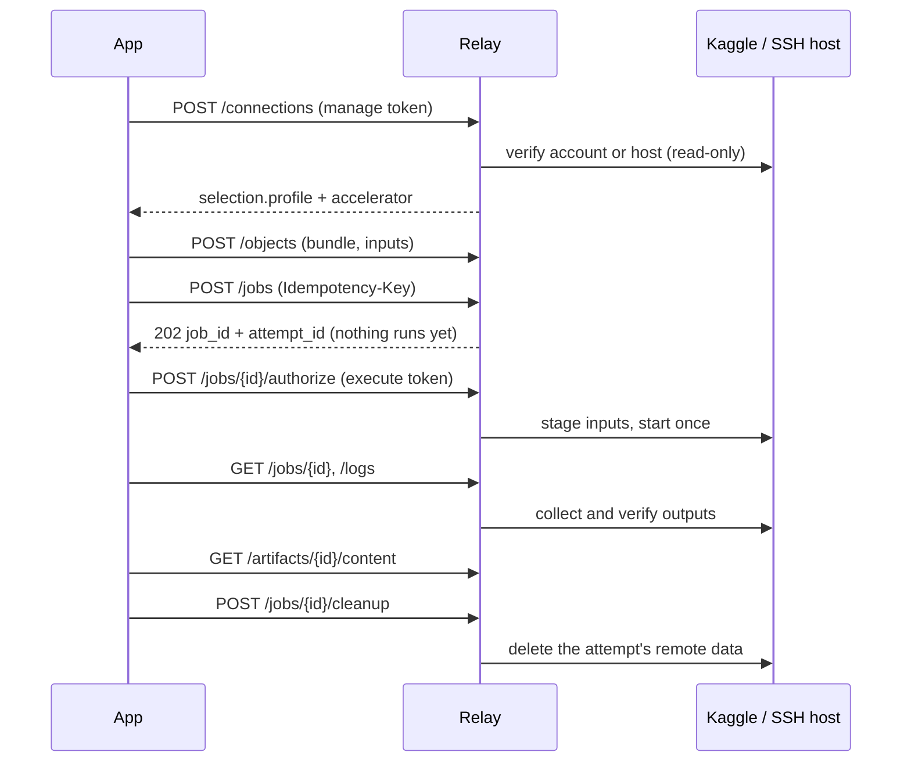

# Getting started

This walkthrough creates an installation, connects an application and runs one small job. Nothing
touches a provider until you create a connection, and nothing runs until you authorize an attempt.



## 1. Create an installation

Use private paths outside the checkout. Parent directories must exist; the runtime directory and
token files must not.

```sh
./compute-relay init --root /abs/private/runtime
./compute-relay workspace create --root /abs/private/runtime --id app
./compute-relay token issue --root /abs/private/runtime --workspace app --scope read --scope write --scope operate --ttl 24h --output /abs/private/app-token
./compute-relay token issue --root /abs/private/runtime --workspace app --scope read --scope manage --ttl 24h --output /abs/private/manage-token
./compute-relay token issue --root /abs/private/runtime --workspace app --scope execute --ttl 24h --output /abs/private/execute-token
./compute-relay serve --root /abs/private/runtime --listen 127.0.0.1:7331
```

Each token is written once to its file; the command prints only a receipt with the token ID (keep it
for revocation). Keep the manage and execute tokens away from the process that produces jobs. Token
scopes are listed in [Operations](operations.md#tokens).

Leave `serve` running. Stop it before other local admin commands, and never delete its lock file.

## 2. Connect the application

Send `Authorization: Bearer <token>` on every request, reading the token from its file. Check
`GET /readyz` and `GET /v1/info`, then create a connection under `/v1/workspaces/app/connections`
with the manage token. See [Connections](connections.md), then [Kaggle](kaggle.md) or
[SSH hosts](ssh-hosts.md). A verified connection returns `selection.profile` and
`selection.accelerator`; copy both into your jobs.

## 3. Package, upload and admit a job

`example-job/main.py`:

```python
from pathlib import Path
import os

Path(os.environ["CC_OUTPUT_DIR"], "answer.txt").write_text("42\n", encoding="utf-8")
```

```sh
./compute-relay bundle create --root ./example-job --include main.py --output ./example-job.tar.gz
```

Upload the archive with `POST /v1/workspaces/app/objects` (`Content-Type: application/octet-stream`,
write token) and keep the returned `object_id`. Then write `job.json`:

```json
{
  "api_version": "compute-connector/v1alpha1",
  "name": "getting-started",
  "profile": "PROFILE_FROM_SELECTION",
  "bundle": {"object_id": "obj_FROM_UPLOAD"},
  "execution": {"kind": "python", "command": ["python", "main.py"]},
  "inputs": [],
  "outputs": [{"path": "answer.txt", "required": true}],
  "resources": {"accelerator": "cpu"},
  "network": {"remote_internet": "disabled"},
  "timeouts": {"remote_wall_seconds": 60, "setup_seconds": 10, "finalization_grace_seconds": 5}
}
```

```sh
./compute-relay validate --file ./job.json
```

`POST` it to `/v1/workspaces/app/jobs` with the write token and an `Idempotency-Key`. The `202`
response holds `job_id` and `attempt_id`; it only means Relay recorded the job.

## 4. Authorize, observe, collect, clean up

1. `POST /jobs/{job_id}/authorize` with the execute token — see
   [Jobs](jobs.md#authorize-an-attempt).
2. Poll `GET /jobs/{job_id}` and `GET /jobs/{job_id}/logs?attempt_id=…`.
3. Download results — see [Results and cleanup](results-and-cleanup.md).
4. `POST /jobs/{job_id}/cleanup` to delete remote data.

SSH jobs can instead stage first and start later: see [Prepare and start](prepare-start.md).
