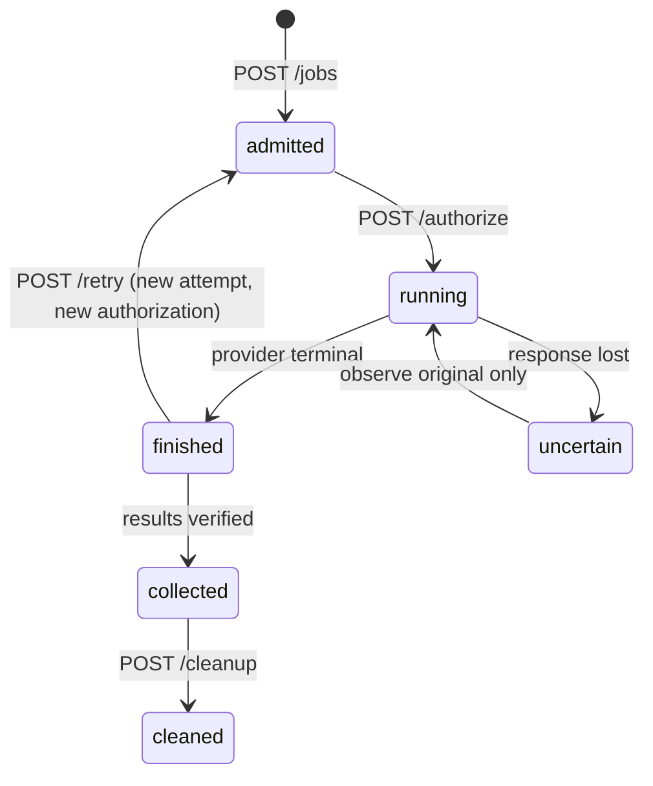

# Jobs

A job is an immutable spec plus its inputs. Each run of it is an *attempt*; an attempt runs only
after you authorize it. Paths below are under `/v1/workspaces/{w}`; exact shapes are in
[job-spec v1alpha1](../api/schemas/job-spec.v1alpha1.schema.json) and [examples](../api/examples/).



## Job spec

| Field | Required | Notes |
|---|---|---|
| `api_version` | yes | `compute-connector/v1alpha1` |
| `name`, `labels` | name | Free text for your application. |
| `profile` | yes | `selection.profile` from a verified [connection](connections.md). |
| `bundle` | yes | `{object_id}` of an uploaded bundle, optionally with `sha256` + `bytes`. |
| `execution` | yes | `kind` (`python` or `shell`), `command` array, optional `working_directory`, `environment` (≤64 vars), `dependencies`. |
| `inputs` | yes | ≤256 entries `{name, source: {kind: "object", object_id}, target}`. |
| `outputs` | yes | ≤64 entries `{path, required, kind?, max_bytes?}`. |
| `resources` | yes | `accelerator` (`cpu`/`gpu`, must match the selection), optional GPU count/memory minimums. |
| `network` | yes | `remote_internet`: `disabled` or `required` (needs `--managed-allow-internet`). |
| `timeouts` | yes | `remote_wall_seconds`, `setup_seconds`, `finalization_grace_seconds`; optional `execution_deadline` ([SSH](prepare-start.md#execution-deadline)). Setup + grace must be less than wall. |
| `result_collection` | no | `automatic` (default) or `manual`. |
| `retention` | no | Automatic remote cleanup; see [results](results-and-cleanup.md#automatic-remote-retention). |
| `execution_control` | no | `combined` (default) or `prepare_then_start` (SSH; see [Prepare and start](prepare-start.md)). |
| `workload_secrets` | no | Secret slots supplied at start (SSH). |
| `application_image` | no | Your own Docker image archive (SSH; see [storage](ssh-storage.md#application-images)). |

Size limits: bundle 100 MiB, each input object 2 GiB, all inputs 4 GiB, wall budget at most the
provider's maximum (Kaggle 24 h, SSH 7 days).

`execution.dependencies` can name a `python_requirements` file inside the bundle — only exact
`name==version` pins, installed as wheels without dependencies, and only when the job has
internet — and `shell_setup` command arrays. Both run inside `setup_seconds`.

## What the workload sees

Inside the attempt the runner provides:

| Variable | Contents |
|---|---|
| `CC_CODE_DIR` | Extracted bundle (the working directory by default) |
| `CC_INPUT_DIR` | Verified inputs at their `target` paths |
| `CC_OUTPUT_DIR` | Write declared outputs here |
| `CC_SCRATCH_DIR` | Temporary space and `HOME` |
| `CC_JOB_ID`, `CC_ATTEMPT_ID`, `CC_EXECUTION_MANIFEST_PATH` | Identity and manifest |
| `CC_SECRET_DIR` | Workload secret files, when declared |

Commands are argument arrays; `$VARS` expand only if you invoke a shell. Ambient credentials and
proxies are not inherited. Only the Python standard library is guaranteed; GPU jobs need PyTorch in
the provider image. Stdout and stderr keep the first 20 MiB each.

## Bundles

```sh
./compute-relay bundle preview --root ./job --include main.py --include src
./compute-relay bundle create --root ./job --include main.py --include src --output ./job.tar.gz \
  --expect-manifest-sha256 DIGEST_FROM_PREVIEW
./compute-relay bundle inspect --file ./job.tar.gz
```

- Includes must exist and not overlap; `.` is not allowed. The output must be a new file outside
  the source directory.
- `preview` lists paths, sizes and hashes; passing its `manifest_sha256` to `create` fails if files
  changed in between.
- Known secret, config, VCS, cache and build paths are always excluded. Add more with a
  [`.computeignore`](../.computeignore.example) (exclusions only, no negation).
- The archive is gzip USTAR with regular files only: `.compute-relay/bundle.json` plus `code/…`.
  Links, special files, unsafe or colliding paths are rejected. No command runs your code.

## Upload and admit

1. Upload the bundle and every input: `POST /objects`, raw bytes,
   `Content-Type: application/octet-stream`, write token. Keep each `object_id`. Objects are
   immutable; there is no URL or host-path import.
2. Optional checks: `compute-relay validate --file job.json` (offline syntax) and
   `POST /jobs/validate` (against current profiles and objects).
3. `POST /jobs` with a write token and an `Idempotency-Key`. The `202` returns `job_id` and the
   first `attempt_id`.

Resending the same body with the same key returns the original receipt; a different body with that
key is a conflict.

## Authorize an attempt

`POST /jobs/{job_id}/authorize` with the execute token and its own `Idempotency-Key`:

```json
{
  "attempt_id": "att_FROM_ADMISSION",
  "max_remote_wall_seconds": 300,
  "authorize_private_staging": true,
  "authorize_compute": true
}
```

- `max_remote_wall_seconds` must equal the job's `timeouts.remote_wall_seconds`.
- GPU jobs need fresh, sufficient known quota; if quota is stale, run a connection `check` first.
  CPU jobs do not reserve GPU time.
- The grant is used up before any provider call. Restarting Relay never creates another one.

## Observe and control

| Request | Token | Purpose |
|---|---|---|
| `GET /jobs/{id}` | read | Status: orchestration, execution, collection, `scheduling.reason`, `problem`. |
| `GET /jobs/{id}/logs?attempt_id=…` | read | Bounded log pages. Keep the cursor; `LOG_CURSOR_RESET` means a gap. |
| `POST /jobs/{id}/cancel` | operate | Records intent; Relay then confirms termination from the provider. |
| `POST /jobs/{id}/reconcile` | operate | Re-observe the original remote resource after failures. |
| `POST /jobs/{id}/retry` | operate | New attempt after the old one is settled; needs a new authorization. |
| `GET /operations/{id}` | read | Outcome of a control request. |

All control requests take `{"attempt_id": …}` and an `Idempotency-Key`. A status of `unknown` stays
unknown until the provider confirms otherwise — a timeout or cancel request is not proof that
remote work stopped.

Cancellation recovery uses the same attempt and frozen provider identity:

| Previous request | New explicit cancel with a new key |
|---|---|
| Still accepted or running | Returns the existing operation. |
| Failed or manual-required before any provider stop invocation began | Creates a new operation; verification and worker fencing still apply. |
| Stop invocation began, including a lost response | Returns the existing operation; use `reconcile` to observe the original resource. |
| Already succeeded | Returns the settled operation without another stop. |

Reusing an old key always returns its original receipt, even after the operation settles; read
`GET /operations/{id}` for its current outcome. A fresh key cannot override an identity mismatch
or an active cleanup. Recovery never creates a new compute attempt or execution authorization.
