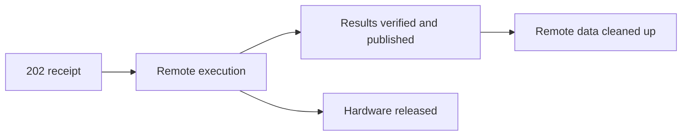

# Operations

How to run, administer, back up, upgrade and recover a Relay installation.

## Serve

```sh
./compute-relay serve --root /abs/private/runtime --listen 127.0.0.1:7331
```

| Flag | Values | Default |
|---|---|---|
| `--listen` | Literal loopback address; port 0 picks a free port | `127.0.0.1:7331` |
| `--managed-machine-shape` | `cpu`, `NvidiaTeslaT4`, `NvidiaTeslaP100` (Kaggle only; SSH is always CPU) | `cpu` |
| `--managed-max-wall-seconds` | 1–86400; an SSH connection can raise its own limit to 604800 | 1800 |
| `--managed-max-workers` | 1–16 local workers | 2 |
| `--managed-allow-internet` | Allows jobs that request remote internet | off |
| `--managed-credential-store` | `file` or `keychain`; see [credentials](#credentials) | `file` for new installations |

Flags only shape *future* connection selections; admitted jobs keep their values, and no flag
authorizes compute. With no connections, Relay makes no provider calls. DNS names, wildcard and
remote listeners are rejected; there is no TLS or remote-exposure option.

To upgrade, stop `serve`, replace the binary and start it on the same root. There is no installer.

Shutdown (Ctrl-C / SIGTERM) gives handlers ten seconds, then closes connections and waits for
workers. Stopping Relay never cancels remote work.

Provider and transport failures become attempt or operation evidence and never stop `serve`. A
corrupted or inconsistent store does: `serve` exits 1 and prints one line naming the worker and a
closed error class, for example `Runtime stopped: service=dispatch class=state_corrupt.`

## Local administration

These commands take the installation lock, so stop `serve` first:

```sh
./compute-relay state --root /abs/private/runtime
./compute-relay workspace show|enable|disable --root /abs/private/runtime --id app
./compute-relay token issue --root /abs/private/runtime --workspace app --scope read --ttl 24h --output /abs/private/new-token
./compute-relay token revoke --root /abs/private/runtime --id tok_FROM_RECEIPT
```

Opening the state applies pending database migrations, even for `state`.

### Tokens

| Scope | Allows |
|---|---|
| `read` | Job status, logs, artifacts, connections, readiness, health, storage view |
| `write` | Upload objects, validate and admit jobs |
| `operate` | Cancel, retry, reconcile, collect, cleanup (and its preview) |
| `manage` | Create and change connections, host watchdog, orphan cleanup |
| `execute` | Authorize attempts, prepare/start grants, workload secrets |

TTL is 1 minute to 30 days (default 24 h). Revoking a token or disabling a workspace blocks future
requests; it does not cancel remote work. If writing the token file fails, Relay tries to revoke the
token and reports `revoked-after-delivery-error` or `revocation-unconfirmed`.

## Credentials

The first `serve` records the vault choice in `state/credential-store`; later starts reuse it.
Passing a different backend is refused — the flag is not a migration tool.

| Backend | Where | Notes |
|---|---|---|
| `file` (default) | `credentials/secrets.env` under the root, `0700`/`0600` | Base64, **not encrypted**; protected only by file permissions. Do not edit, source or copy it. |
| `keychain` | macOS Keychain (native API) | A replaced binary may need macOS access permission for the existing items. Relay never prompts, widens access or recreates items. |

Relay never falls back to the other backend or recreates a missing credential. If access fails, keep
the original binary and vault and fix access. Credentials are added, replaced and removed only
through the [connection API](connections.md); they never appear in API responses or SQLite.

## Backup and restore

There is no backup command. Back up a **stopped** installation as a whole:

1. Stop Relay and wait for the lock to release.
2. Copy the entire runtime root: SQLite and its WAL/sidecars, both blob stores,
   `.compute-relay-runtime`, the `.retention-id` and format markers, `state/credential-store` and
   `credentials/` (file vault). Keychain items stay in the Keychain. Keep the matching binary.
3. Restore all of it together into a private location. Do not `init` over it, edit markers or
   force it open with SQL.
4. Check restored tokens and grants against newer revocations. Never run the original and the
   restored copy at the same time against the same provider account or host.

A live copy of the database file can miss committed WAL data. A database-only backup lacks blobs and
credentials. A backup does not stop remote work or bring back deleted bytes.

Requirements: Linux or macOS with normal Unix permissions, a dedicated private directory, local
disk. Network filesystems and arbitrary power loss are not qualified.

## Upgrades

Migrations are numbered and checksummed. Newer, foreign, edited or gapped state is refused, and
downgrade is unsupported. Keep a stopped backup before upgrading. Schema v14 and v22 roots are
tested to upgrade with their jobs, receipts, connections and artifacts intact.

## Local retention

The input store holds at most 32 GiB and the result store 8 GiB; an upload that would exceed its
store fails with `disk_limit_exceeded` until retention frees space.

| Data | Minimum age before deletion |
|---|---|
| Unreferenced input objects | 24 hours |
| Verified results and safe completed references | 7 days |

Anything still in use (active or unknown execution, pending collection or operations, shared
references) is kept regardless of age. Expiry writes a tombstone first; history and metadata stay,
and new downloads return HTTP 410. The sweep runs at startup and hourly. Local retention never
deletes remote data — see [remote retention](results-and-cleanup.md#automatic-remote-retention).

## Recovery

First rule: keep the original receipt, idempotency key, attempt ID, runtime root and binary. Never
reset state, delete rows, clear capacity or submit a replacement because a response went missing.
These are separate facts — one does not imply another:



| Situation | What to do |
|---|---|
| Lost response to a request | Resend the identical request with the **same** key; then read state. |
| Error before Relay recorded intent | Nothing external happened; check state, then retry the local step. |
| Remote call uncertain after intent was recorded | Relay observes the original resource only. Wait; do not resubmit. |
| Staging stalled before submission | `POST /jobs/{id}/reconcile` observes the original staging. Without a previously confirmed resource, one bounded unsuccessful pass ends the attempt with `staging_unconfirmed`; a new attempt requires explicit intent. Confirmed pending staging stays distinct. |
| Submission rejected before reaching the provider | Read `problem.details.reason`, fix the cause, retry explicitly. |
| Temporary observation outage after confirmed submission | Relay keeps observing the same run with backoff, including after restart. No resubmission. |
| Remote state active or unknown | Capacity stays reserved. Do not delete; reconcile if the attempt requires attention. |
| Cancellation ended before its provider stop invocation began | Restore connectivity or credentials, then explicitly cancel the same attempt with a new key. Relay preserves the old receipt and verifies the frozen identity again. |
| Cancellation may already have invoked the provider | Reconcile the original attempt. A fresh cancel key cannot grant another stop invocation. |
| Cancellation unsupported or target missing | Termination stays manual-required/unknown. |
| Finished, results missing, or `collection.state=awaiting_request` | `POST /jobs/{id}/collect` for the same attempt — not a compute retry. |
| Collection failed and committed | One new collect request with a new key. |
| Download failed after writing a local file | Inspect that file and the request; never overwrite it automatically. |
| Results expired | History stays. Do not rerun compute to get them back. |
| Identity, version or root mismatch | Stop and keep evidence; do not adopt a replacement or edit markers. |

For a bug, keep raw state and logs private. Report the binary revision, exact command, actual
result, possible remote effects and a minimal sanitized reproduction.
