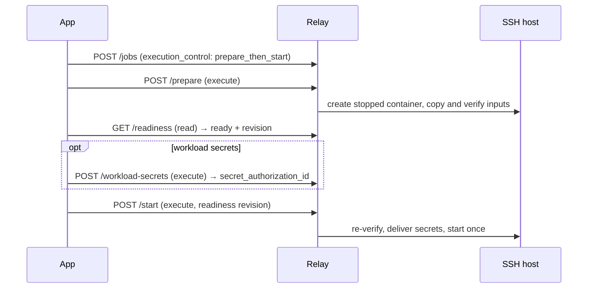

# Prepare and start (SSH)

SSH jobs can split one authorization into two: stage inputs into a stopped container first, then
start it later — optionally with an absolute UTC deadline and secrets delivered only at start.
Kaggle supports none of this and rejects such jobs before preparation.

Requirements: runtime feature `separate_prepare_start`, provider capabilities
`separate_prepare_start: "supported"`, `absolute_execution_deadline` (for deadlines) and
`ephemeral_workload_secrets` (for secrets). Paths below are under `/v1/workspaces/{w}/jobs/{job_id}`.



## 1. Prepare

`POST /prepare` with an execute token and an `Idempotency-Key`:

| Field | Value |
|---|---|
| `attempt_id` | The attempt from admission |
| `max_preparation_seconds` | 1–3600. Budget mainly for the upload: 1 GB on a slow link can need over 10 minutes. |
| `ready_until` | UTC `YYYY-MM-DDTHH:MM:SSZ`, at most 1 hour ahead and not after the job deadline |
| `max_staged_bytes` | 1–4399824896, total bundle + input bytes |
| `authorize_private_staging` | `true` |

Relay checks the pinned image, creates a stopped container and copies the runner and inputs. A
fixed verifier hashes the files on the host — only digests and sizes cross SSH — before readiness
and again before start. No workload code runs. At most four outstanding preparations per account and
sixteen in total. A prepared container keeps its capacity slot until it starts or is cleaned up, so
use a short hold and clean up unused preparations.

## 2. Read readiness

`GET /readiness` (read token) returns `state` and `required_actions`. States: `preparation_required`,
`queued`, `preparing`, `ready`, `start_authorized`, `starting`, `started`, `expired`, `prevented`,
`invalidated`, `uncertain`. When `ready`, it includes `revision`, `observed_at`, `ready_until` and
`staged_bytes`.

## 3. Supply secrets (optional)

Declare slots in the job:

```json
"workload_secrets": [{"name": "ingest", "exposure": "file_and_local_process_arguments"}]
```

`exposure` is `file` (read-only file in `CC_SECRET_DIR`) or `file_and_local_process_arguments`
(the workload may also pass the value to a local tool's arguments). After readiness, `POST
/workload-secrets` with an execute token and an `Idempotency-Key`:

```json
{
  "attempt_id": "att_example",
  "readiness_revision": "REVISION_FROM_READINESS",
  "expires_at": "2026-10-20T12:00:00Z",
  "values": {"ingest": "BASE64_VALUE"}
}
```

Limits: 8 slots, 8 KiB each, 32 KiB total, expiry at most 24 h ahead. The receipt contains only
names and expiry. Values live only in Relay memory until start, then in a 128 KiB tmpfs inside the
container (mode `0400`). They are never stored in SQLite, job JSON, argv or environment. Known
values are redacted from logs and blocked from artifacts — best effort, not protection against a
workload that leaks its own input.

- After a Relay restart before start, readiness reports `material_lost`; resend the exact same
  supply request to restore it.
- Revoke unused values: `POST /workload-secrets/{id}/revoke` with `{"attempt_id": …}`.
- Once consumed, values are never resent.

## 4. Start

`POST /start` with an execute token and an `Idempotency-Key`:

| Field | Value |
|---|---|
| `attempt_id` | The prepared attempt |
| `readiness_revision` | The `revision` from readiness |
| `max_remote_wall_seconds` | At most the admitted budget, greater than setup + grace |
| `execution_deadline` | UTC timestamp at most that many seconds ahead, not after the job deadline |
| `secret_authorization_id` | When the job declares secrets |
| `authorize_compute` | `true` |

Start must happen before `ready_until`, `execution_deadline` and the secret expiry. Those expiries
only bound the *start*; once running, the attempt may run until its deadline (up to 7 days). Relay
re-verifies the container and bytes, then starts it exactly once.

Replays return the original receipt (`replay: true`), and `GET /gate-authorizations/{id}` reads it.
A second grant for the same attempt is a conflict. If a start may have reached Docker, recovery only
observes it. To abandon a prepared attempt, `POST /cancel`, then `POST /cleanup`.

## Execution deadline

An optional absolute end time in the job, fixed for every attempt of it:

```json
"timeouts": {
  "remote_wall_seconds": 3600,
  "setup_seconds": 120,
  "finalization_grace_seconds": 30,
  "execution_deadline": "2026-10-20T20:00:00Z"
}
```

Use exactly `YYYY-MM-DDTHH:MM:SSZ`. After it passes, admission, authorization and retry return
`REMOTE_TIMEOUT` (exact replays still return their original receipt).

| Phase | Ends at |
|---|---|
| Setup + payload | The earlier of the deadline and `runner start + wall − grace`; setup also has `setup_seconds` |
| Result finalization | The earlier of `runner start + wall` and `deadline + grace` |

- Before starting, Relay requires the Docker engine clock within **5 s** of Relay's clock; otherwise
  it reports `clock_skew_unverified` and does not start. Keep host, Docker VM and Relay clocks in sync.
- The runner checks UTC and Linux `CLOCK_BOOTTIME` every 50 ms and sends TERM, then KILL within
  about 1 s. The container supervisor adds at most 2 s. Timeouts exit with code 124.
- Nothing can stop work while the host is asleep or powered off; expiry is acted on after resume.
  Sleep, reboot and engine restart are not yet tested live.
- A deadline that expires before submission reports `execution=not_submitted`,
  `deadline_exceeded=true`, reason `absolute_deadline_expired`. After a possible start, losing
  contact past the deadline is not proof the work stopped.
