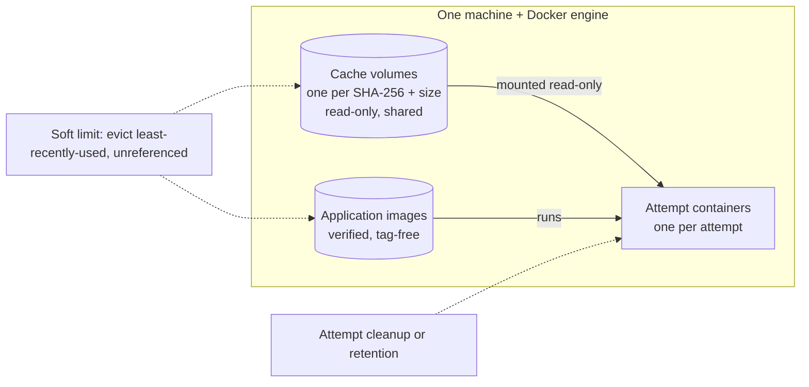

# SSH storage, cache and application images

Relay accounts for cache volumes, application images and attempt containers on an SSH host.
These objects are labelled with the installation and scoped to one verified machine + Docker
engine, so every connection alias to that machine shares them. Kaggle uses none of this; it reuses large inputs through
[shared datasets](kaggle.md#shared-input-datasets).



| Object | Lifetime | Removed by |
|---|---|---|
| Cache volume | Shared across jobs and workspaces | Soft-limit or count-limit eviction when unreferenced |
| Application image | Reused across jobs | Soft-limit or count-limit eviction when unreferenced |
| Attempt container | One attempt | [Cleanup or retention](results-and-cleanup.md#cleanup) |

## Input cache

The bundle and every input object are cached by their SHA-256 and byte count. A cache hit sends no
bytes over SSH; a miss streams the object into a new volume and verifies it on the host. Attempts
mount entries read-only, and Relay re-verifies them before readiness and start.

You may assert the identity next to each `object_id`; admission then checks it against Relay's
records. Give both fields or neither:

```json
"bundle": {"object_id": "obj_bundle", "sha256": "0123…cdef", "bytes": 123456}
```

A corrupt or missing entry is never used: Relay retires it and writes a new one. A cache entry used
by a queued, running, uncertain or still-mounted attempt is never evicted.

Warm cache checks read one filtered volume inventory for the frozen installation, machine and
Docker engine, then verify up to 64 exact read-only volumes per helper. A pass over the maximum
257 distinct contents (bundle plus 256 inputs) uses at most five helpers. Preparation keeps both
its selection and post-mount readiness passes (at most ten helpers); reconciliation and start
each use one pass. Every pass keeps the caller's original deadline. Incomplete metadata or
helper replies remain unknown and never authorize replacing a generation.

## Application images

A job can bring its own Docker or OCI image archive (uploaded as an object, ≤2 GiB):

```json
"application_image": {"object_id": "obj_image", "sha256": "0123…cdef", "bytes": 456789}
```

Relay verifies the archive, accepts exactly one `linux` image for the host's architecture,
re-labels it without tags and loads it once; later jobs reuse the same image ID. The image must not
declare an entrypoint or volumes (Relay's runner must be the process). No Dockerfile build, registry
pull, package install or `docker tag` happens. Kaggle rejects the field.

Each installation on a verified machine and Docker engine has **16 application-image
slots**, counting distinct resident or uncertain image identities and pending image pins.
Reusing an existing image key needs no new slot. A new image at the limit is refused with
`host_image_count_limit` before preparation starts; an unknown load retains its slot.
The storage worker keeps an idle target of **15 images**, leaving one slot for the next
image. It removes only exact, unpinned, unreferenced images through the normal cleanup
journal. Pending or uncertain deletion does not free a slot or permit repeating that deletion.
Older installations already above the limit retain pinned and uncertain images; existing
active keys remain usable while new distinct images wait for safe cleanup.

## Budget

New SSH connections default to a **64 GiB soft** and **80 GiB hard** limit. Set your own via
`configure` (soft < hard ≤ 1 PiB):

```json
"storage_budget": {"soft_bytes": 68719476736, "hard_bytes": 85899345920}
```

Across aliases of one machine the lowest values win. Physical objects are charged once; image size
is a conservative upper bound.

| Usage | Effect |
|---|---|
| Below soft | Nothing. |
| Above soft | Evict unreferenced cache entries and images, least recently used first. |
| Over 64 cache volumes | Evict unreferenced cache volumes, least recently used first, whatever their size (`count_limit_lru`). |
| Over 15 application images | Evict unreferenced application images, least recently used first, independent of size (`image_count_limit_lru`); active pins and uncertain loads remain. |
| At or near hard, or unknown | New admission and preparation get HTTP 422 `RESOURCE_REQUIREMENT_UNSATISFIED` with `details.reason` `host_storage_limit` or `host_storage_unknown`; queued work retries every 30 s. Running work is never stopped. |

Size the budget to Docker's own capacity (the Docker VM on macOS), not host `df`.

## Storage view and orphans

`GET /v1/workspaces/{w}/connections/{id}/storage` (read token) shows totals per class, workspace
references, cache pins, pending retention, orphan summaries, budget state (`below_soft`,
`above_soft`, `hard_refusal`, `unknown`) and scan completeness. It never exposes Docker IDs, paths
or other workspaces' jobs. An incomplete scan proves nothing absent. Container usage is read from Docker's filtered summary, which remains available while a stopped container streams a result archive; volumes and images are inspected in batches of 64 per command, so a scan stays within its 30 s bound as objects accumulate. An incomplete scan records the failed step (for example `storage_inspect_incomplete`, `storage_container_summary_failed`, `remote_scan_timeout`, or the transport/identity check). The storage view exposes this closed `reason`; new-work refusals retain `host_storage_unknown` as their summary and the same step in `details.cause`. Missing size information still makes storage unknown; a download never bypasses the storage budget. Exact cleanup separately re-inspects its target before deletion.

An *orphan* is a labelled object with no matching Relay record. Objects of other installations are
only counted, never touched; unlabelled objects are ignored. To remove an orphan (manage token,
paths under `/v1/workspaces/{w}`):

1. Pick an eligible orphan ID from the storage view.
2. Preview: `GET /connections/{c}/storage/orphans/{orphan}/cleanup`.
3. Before the preview expires, `POST` the same path with an `Idempotency-Key` and
   `{"fingerprint": "<from preview>"}`.
4. Follow `Location` to `/storage-cleanup-operations/{op}` (read token). If the host is
   unreachable while an interrupted removal recovers, the operation stays `running` and is observed
   again after its lease expires.

Attempt containers that match a job use ordinary [attempt cleanup](results-and-cleanup.md#cleanup)
instead. See the [storage schema](../api/schemas/connection-storage.v1alpha1.schema.json).

## Remote resource bounds

These limits complement byte accounting; tiny objects and uncertain mutations still consume
capacity. Admission shares the physical host scope across connection aliases. Unknown creation
outcomes never free a reservation or authorize a repeated create, image load or build.

| Resource created by Relay | Count or lifetime bound | Ownership and removal |
|---|---|---|
| Attempt container and private writable data | 128 retained, live or uncertain attempt reservations per physical resource; configured running concurrency also applies | One exact attempt container; ordinary cleanup or retention rechecks identity before removal. |
| Private job volumes | None | Standard runner recipes declare no volumes; application archives with declared volumes are rejected. Inputs/outputs live in the container layer; optional secrets use a bounded tmpfs removed with that container. |
| Shared input-cache volumes | 64-generation count policy plus byte budget; active pins prevent unsafe eviction | One exact labelled generation per content key; only unreferenced owned generations are eligible for eviction. |
| Application images | 16-generation count policy plus byte budget | Exact verified image IDs, tag-free; only unreferenced owned generations are eligible for eviction. |
| Standard runner images and tags | Fresh builds require fewer than 16 distinct matching IDs; at most 16 durable installation operations per physical machine | Each operation can build once and has one operation tag plus its recipe tag. Existing operation recovery never builds; no age, prefix or legacy-image deletion. |
| Cache writer helpers | Fixed generation name, one writer invocation, two-hour process alarm, `--rm` | Durable write intent precedes the one-shot writer. Unknown results are observed without repeating the writer. |
| Cache and stopped-container verifier helpers | One-hour process alarm, `--rm`; up to 64 exact read-only cache mounts per helper | No job code runs in helpers. Disconnected helpers can remain until their process exits; later observation may launch another verifier, never another attempt. |
| macOS host watchdog | One fixed installation directory and launchd label per installed plan | Three managed files and five fixed runtime file paths; the stop ledger holds at most 64 IDs. A changed plan requires explicit removal; unknown unload preserves files. |

The standard runner inventory is a complete, bounded `image ls --all --no-trunc` response filtered
by the runner schema label. It counts matching legacy and foreign images only as occupied capacity;
that observation grants no deletion authority and exposes no image IDs in public reasons.
Malformed, partial, oversized or failed inventory replies block fresh builds with a closed failed-step
reason. Exact operation recovery bypasses this capacity gate because it cannot create anything.

The pinned Python base image is a shared Docker dependency, not a Relay-owned deletion target.
Unrelated images and objects left by external tools are outside these creation limits and never
become removable through a name prefix or an age threshold. The bounds do not claim to impose a
quota on external Docker clients or to reap a stopped Docker daemon's objects while it is offline.
