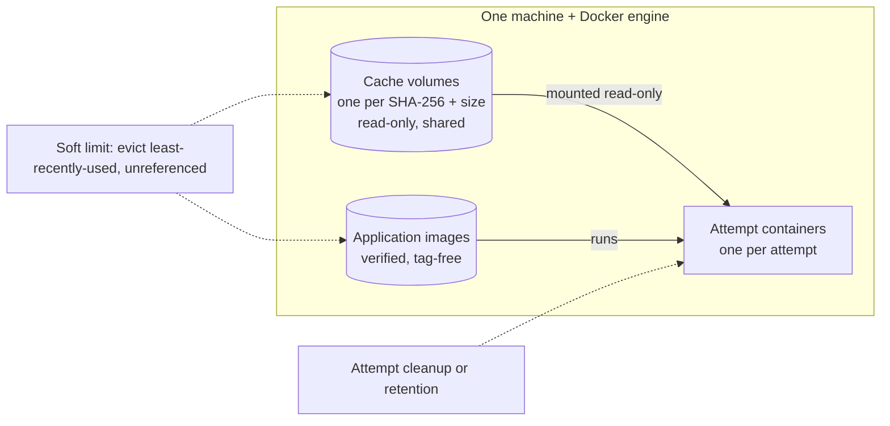

# SSH storage, cache and application images

Relay keeps three kinds of Docker objects on an SSH host. All are labelled with the installation
and scoped to one verified machine + Docker engine, so every connection alias to that machine shares
them. Kaggle uses none of this; it reuses large inputs through
[shared datasets](kaggle.md#shared-input-datasets).



| Object | Lifetime | Removed by |
|---|---|---|
| Cache volume | Shared across jobs and workspaces | Soft-limit or count-limit eviction when unreferenced |
| Application image | Reused across jobs | Soft-limit eviction when unreferenced |
| Attempt container | One attempt | [Cleanup or retention](results-and-cleanup.md#cleanup) |

## Input cache

The bundle and every input object are cached by their SHA-256 and byte count. A cache hit sends no
bytes over SSH; a miss streams the object into a new volume and verifies it on the host. Attempts
mount entries read-only, and Relay re-verifies them before readiness and start.

You may assert the identity next to each `object_id`; admission then checks it against Relay's
records. Give both fields or neither:

```json
"bundle": {"object_id": "obj_bundle", "sha256": "0123…cdef", "bytes": 123456}
```

A corrupt or missing entry is never used: Relay retires it and writes a new one. A cache entry used
by a queued, running, uncertain or still-mounted attempt is never evicted.

## Application images

A job can bring its own Docker or OCI image archive (uploaded as an object, ≤2 GiB):

```json
"application_image": {"object_id": "obj_image", "sha256": "0123…cdef", "bytes": 456789}
```

Relay verifies the archive, accepts exactly one `linux` image for the host's architecture,
re-labels it without tags and loads it once; later jobs reuse the same image ID. The image must not
declare an entrypoint or volumes (Relay's runner must be the process). No Dockerfile build, registry
pull, package install or `docker tag` happens. Kaggle rejects the field.

## Budget

New SSH connections default to a **64 GiB soft** and **80 GiB hard** limit. Set your own via
`configure` (soft < hard ≤ 1 PiB):

```json
"storage_budget": {"soft_bytes": 68719476736, "hard_bytes": 85899345920}
```

Across aliases of one machine the lowest values win. Physical objects are charged once; image size
is a conservative upper bound.

| Usage | Effect |
|---|---|
| Below soft | Nothing. |
| Above soft | Evict unreferenced cache entries and images, least recently used first. |
| Over 64 cache volumes | Evict unreferenced cache volumes, least recently used first, whatever their size (`count_limit_lru`). |
| At or near hard, or unknown | New admission and preparation get HTTP 422 `RESOURCE_REQUIREMENT_UNSATISFIED` with `details.reason` `host_storage_limit` or `host_storage_unknown`; queued work retries every 30 s. Running work is never stopped. |

Size the budget to Docker's own capacity (the Docker VM on macOS), not host `df`.

## Storage view and orphans

`GET /v1/workspaces/{w}/connections/{id}/storage` (read token) shows totals per class, workspace
references, cache pins, pending retention, orphan summaries, budget state (`below_soft`,
`above_soft`, `hard_refusal`, `unknown`) and scan completeness. It never exposes Docker IDs, paths
or other workspaces' jobs. An incomplete scan proves nothing absent. Container usage is read from Docker's filtered summary, which remains available while a stopped container streams a result archive; volumes and images are inspected in batches of 64 per command, so a scan stays within its 30 s bound as objects accumulate. An incomplete scan records the failed step: `remote_scan_timeout`, `remote_docker_failed`, `remote_response_limit`, `host_unavailable`, `host_key_mismatch`, `credential_rejected`, `storage_identity_unverified`, `remote_scan_invalid` or `remote_observation_failed`. Missing size information still makes storage unknown; a download never bypasses the storage budget. Exact cleanup separately re-inspects its target before deletion.

An *orphan* is a labelled object with no matching Relay record. Objects of other installations are
only counted, never touched; unlabelled objects are ignored. To remove an orphan (manage token,
paths under `/v1/workspaces/{w}`):

1. Pick an eligible orphan ID from the storage view.
2. Preview: `GET /connections/{c}/storage/orphans/{orphan}/cleanup`.
3. Before the preview expires, `POST` the same path with an `Idempotency-Key` and
   `{"fingerprint": "<from preview>"}`.
4. Follow `Location` to `/storage-cleanup-operations/{op}` (read token). If the host is
   unreachable while an interrupted removal recovers, the operation stays `running` and is observed
   again after its lease expires.

Attempt containers that match a job use ordinary [attempt cleanup](results-and-cleanup.md#cleanup)
instead. See the [storage schema](../api/schemas/connection-storage.v1alpha1.schema.json).
